<!-- hero:start -->
<picture>
  <source media="(prefers-color-scheme: dark)" srcset="./assets/hero-dark.svg">
  <source media="(prefers-color-scheme: light)" srcset="./assets/hero-light.svg">
  
</picture>
<!-- hero:end -->

<samp><a href="https://www.rinda.ai/">rinda.ai</a> · <a href="https://grinda.ai/en">grinda.ai</a> · <a href="https://www.linkedin.com/in/grindaaihojin">linkedin</a> · <a href="https://x.com/web3devdev">x</a> · <a href="mailto:hogingpt@grinda.ai">hogingpt@grinda.ai</a></samp>

I'm Hojin, founder and CEO of [GRINDA AI](https://grinda.ai/en) in Daejeon, Korea. We build AI agents so that a five-person company can sell in seventeen countries.

I write the specs, review the diffs, and decide what merges. Agents do the rest. The graph below is what that looks like when it becomes a habit.

### Building

**[RINDA](https://www.rinda.ai/)** &nbsp;·&nbsp; AI sales agent for exporters 
Finds overseas buyers, writes to each one in their own language, and books the meeting. Nothing sends until a person approves it. Used by 1,100+ B2B exporters.

**[Ara](https://grinda.ai/en/products/ara)** &nbsp;·&nbsp; AI employee 
Hand it work in Slack or KakaoTalk, get the finished file back for review. Every run stays on record. Our own team runs on it.

**[claude-rinda-plugin](https://github.com/FINGU-GRINDA/claude-rinda-plugin)** &nbsp;·&nbsp; RINDA inside Claude Code 
`/rinda-ai:rinda find cosmetics importers in the US` returns buyers, enriched contacts, and a six-step outreach sequence. Rust CLI + MCP.

### How I work with agents

- **Brief them like a senior hire.** Problem, constraints, priority, and how we'll know it worked. A vague prompt gets a vague PR.
- **Every PR explains itself.** What changed, why, and how it was verified. That's how 2,670 of them stay reviewable.
- **People sign off on anything a customer sees.** RINDA never sends an email you didn't approve. Ara asks before it ships.
- **Fix the system, not the output.** When an agent makes the same mistake twice, the lesson goes into the playbook, not just the patch.

2026 through Oct 23: 4,032 commits and 2,670 pull requests across 90+ repositories in 5 organizations. Most of it is private product code, so GitHub shows the count, not the code.

### Track record

TIPS-selected (2023) · CES 2024 exhibitor · Runner-up, Global Generative AI Hackathon (2024) · Hana 1Q Agile Lab, batch 17 (2026) · World IT Show 2026

### Talk to me if you

- export B2B and want buyers abroad without hiring a rep for every country;
- build agents that do real work and want to compare notes;
- back AI-native teams building from Korea for the world.

<!-- stats:start -->
<samp>7,094 contributions in the last 12 months · 262 active days · ~27 per active day · updated Oct 23, 2026</samp>
<!-- stats:end --> 
This page redraws itself every morning (KST) from my public contribution graph. No dependencies, no third-party widgets: [scripts/build.mjs](./scripts/build.mjs).
