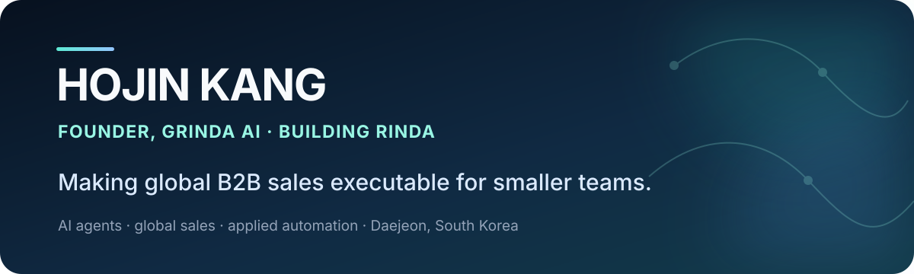

  

  <a href="https://www.rinda.ai/">RINDA</a> ·
  <a href="https://grinda.ai/en">GRINDA AI</a> ·
  <a href="https://github.com/FINGU-GRINDA">Product lab</a> ·
  <a href="mailto:hogingpt@grinda.ai">Email</a>

## Building the AI-native infrastructure for global B2B sales

I'm **Hojin Kang**, founder and CEO of **GRINDA AI** in Daejeon, South Korea.

I build AI agents that help smaller teams operate globally. Our flagship product, **[RINDA](https://www.rinda.ai/)**, connects overseas buyer discovery, qualification, personalized multilingual outreach, and reply management in one workflow.

The goal is simple: **great products should win customers anywhere, regardless of company size.**

## What I'm building

### [RINDA — AI global sales agent](https://www.rinda.ai/)

RINDA helps export-focused B2B teams:

- discover and qualify potential overseas buyers;
- create buyer-specific outreach in multiple languages;
- run follow-up sequences and manage replies in one place;
- keep negotiation and final decisions under human control.

### [GRINDA AI — applied AI agents](https://grinda.ai/en)

At GRINDA AI, we turn repetitive sales, marketing, and document work into traceable operating systems. I work across product, AI, go-to-market, and the unglamorous last mile between a prototype and a workflow people can trust.

## Selected public builds

| Project | What it explores |
| --- | --- |
| [rinda-video-ask](https://github.com/FINGU-GRINDA/rinda-video-ask) | Conversational video experiences for product discovery and booking |
| [rinda-lead-search](https://github.com/FINGU-GRINDA/rinda-lead-search) | AI-assisted lead and buyer research |
| [rinda-callops](https://github.com/FINGU-GRINDA/rinda-callops) | Operational tooling around AI-assisted sales calls |
| [Saydo](https://github.com/FINGU-GRINDA/saydo) | Voice-to-action workflows across software tools |
| [VoicePilot](https://github.com/FINGU-GRINDA/voicepilot) | A no-code builder for voice agents |

## How I build

- **Evidence before automation** — a useful agent should show why it made a recommendation.
- **Human judgment at the boundary** — automate repetitive execution, not accountability.
- **End-to-end over demo-only** — the last mile from signal to action is the product.
- **Global by default** — language, market context, and local operating constraints belong in the system design.

## Let's connect

I'm interested in practical conversations with:

- B2B teams building repeatable overseas sales;
- AI-agent and sales-tech builders;
- global partners working with Korean products and companies.

**[Explore RINDA](https://www.rinda.ai/)** · **[Meet GRINDA AI](https://grinda.ai/en)** · **[hogingpt@grinda.ai](mailto:hogingpt@grinda.ai)**

Public repositories are a mix of product experiments, prototypes, and open-source learning. Production systems and customer data remain private.
